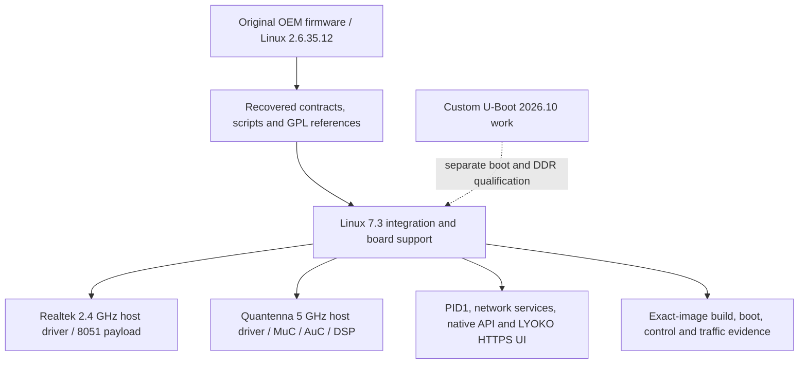

# OpenMitraStar HGW500

> Public source snapshot. [Scope, provenance and verification](docs/PUBLIC_SNAPSHOT.md).

OpenMitraStar is my firmware and reverse-engineering project for the MitraStar HGW-500BNA-QCv2 A2. I work across the boot chain, Linux, host drivers, radio microfirmware and HTTPS management. The goal is to understand the original system and bring a maintainable Linux 7.3 stack to the hardware, while preserving recovery and per-unit data.

## How this component fits



This diagram shows software ownership and analysis flow, not a complete board schematic.
The [system architecture](docs/SYSTEM_ARCHITECTURE.md) explains the ARC750 host,
MuC, AuC, DSP and Realtek 8051, with their memory and firmware boundaries.

## What is established

| Area | Recorded scope |
| --- | --- |
| Hardware | ARC750 LHost at 500 MHz, three Quantenna radio coprocessors and a Realtek 8051 MCU. Five execution units do not mean five Linux SMP CPUs. |
| Bootloader milestone | A custom U-Boot 2026.10 build reached its prompt and was tested on the device. The OEM loader initialized DDR before the RAM handoff; independent reset-to-DDR startup remains WIP. |
| Recorded integration | API v2 R3 has recorded installed acceptance from 8 November: management, five LED channels, both radios and both Ethernet links. This is recorded evidence, not a live status query. |
| Published source boundary | This GitHub repository retains an earlier source/handoff snapshot. Current local integration and frozen R3 inputs are newer; this documentation does not pretend all current source bodies have been republished. |
| Firmware families | OEM SquashFS/kernel recovery and replacement Linux 7.3/initramfs work have separate provenance and acceptance. The component called latest-firmware preserves Core Boot R1. |

## Start reading here

1. [Component handoff](docs/PROJECT_HANDOFF.md): inputs, evidence and next work.
2. [System architecture](docs/SYSTEM_ARCHITECTURE.md): processors and firmware families.
3. [Firmware contents](docs/FIRMWARE_MAP.md): OEM, Core Boot R1 and API v2 R3.
4. [Repository map](docs/REPOSITORY_MAP.md): host drivers, payloads and integration.
5. [Published checkout availability](docs/CHECKOUT_AVAILABILITY.md): actual remote source inventory.
6. [Preserved technical notes](docs/REFERENCE_NOTES.md): detailed earlier results, with workstation paths normalized.

## Work in progress

Complete independent reset-to-DDR boot, missing OEM and radio semantics, QDRV shutdown, candidate-specific channel/width transitions, calibrated RF/DFS and prolonged load. Reconcile any new source publication against the frozen release maps before calling it a reproducible current image.

## Offline verification


```sh
python tools/verify_public_export.py
```

This checks the published file inventory. Original preservation verifiers and
receipts describe the private source checkpoint; they can require omitted native
databases or external inputs and are not a fresh public-snapshot qualification.

## Preservation and scope

This is a public source snapshot; per-unit data and original private histories remain private. Original vendor/GPL source, notices, comments,
carriers and immutable evidence retain their authorship and provenance. Derived
C is labelled as inferred analysis, not silently presented as original source.
Credentials, unit identity, calibration, personalized rootfs/flash images and
workstation-specific configuration stay outside documentation exports.

Documentation prepared 2026-11-10 from recorded source/evidence. No device access,
firmware installation, radio change or new physical qualification is implied.
