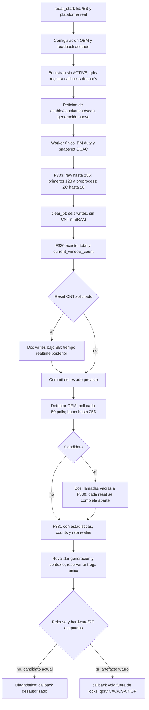

# F332: integración del proveedor radar Linux 5.10

> **NO-GO de carga kernel, confirmado 21-09-2026.** Los builds/oracles siguientes
> siguen siendo evidencia offline, pero el bundle actual no es cargable:
> `kernel/module.c:1432..1478` propaga taint propietario y rechaza módulos que lo
> combinen con símbolos GPL-only. El proveedor importa los motores Proprietary
> junto a `ktime_get`, `mod_delayed_work_on` y APIs GPL-only de F331. qdrv también
> importa 25 APIs kernel GPL-only y heredaría el taint. No se alteran licencias,
> exports, kernel ni políticas para eludirlo. La resolución debe separar la
> matemática OEM en userspace mediante UAPI, o completar una reconstrucción
> nativa GPL; el empaquetador F332 se ha cerrado explícitamente mientras tanto.

Trabajo del 21 de septiembre de 2026. Solo HGW-500BNA-QCv2 A2. Esta tarea no ha
abierto UART, accedido al equipo, cambiado red ni ejecutado un flash.

## Qué está integrado

F332 separa control y matemáticas sin falsear licencias. El proveedor GPL
`qtn_radar_f332.ko` contiene peticiones compatibles con F327, captura F333,
postfiltro F331, reglas de generación y un backend MMIO explícito. Consume
`f332_detector_engine.ko` y `f330_preprocess_engine.ko`, ambos Proprietary porque
contienen los bytes OEM originales. `f331_postfilter_port.ko` es GPL y contiene
el C reconstruido. El motor propietario no importa símbolos GPL-only.

La nueva fachada del detector acepta 256 pulsos procesados, count=1 y timestamps
completos de 32 bits. Esto se amplió después de un oracle original con 110
vectores, canaries, cruces de 27 bits y wrap de 32 bits. F328 no se modificó.

No se marca `postfilter_applied` hasta ejecutar F331 con todas sus entradas.
Los counts de la detección se conservan antes de los dos flushes. Se copian los
128 índices ZC originales de F330 al `detect_sta` privado del detector.

## Cadencia, tráfico y relojes

El worker nominal usa 50 ms. El muestreo de tráfico se decide con el contador
de polls **antes** de incrementarlo, módulo signed 20. `detect_radar_poll` se
decide con el contador **ya incrementado**, módulo unsigned 50. El primer poll
toma rate y el poll 50 llama al detector periódico. El contador y ring de rate
se conservan al cambiar contexto; un `radar_start` completo sí reproduce el
reset de estadísticas original.

La entrada de rate es `driver_sample.tx_bytes`, en bytes/s. El objeto OEM
`detect_drv_sample` mide ocho bytes: su spinlock UP sin debug tiene tamaño cero,
por lo que la carga de +4 es `tx_bytes`. El estado inicial cero es el BSS
original conocido, no un sustituto de una fuente ausente. F332 espera que qdrv
obtenga el objeto mediante el getter y después lee el campo real bajo su lock.
Registro del productor no se presenta como prueba de un período MuC fresco.

El reloj de timers OEM usa HZ=200: nanosegundos monotónicos / 5.000.000, con wrap
de 32 bits. El origen temporal de F330 es distinto: tras los writes CNT se
toma `ktime_get_real_ts64` y se calcula `sec*10.000.000 + usec*10`, módulo 32.
No se confunden esos dos orígenes.

## Captura y OCAC

F333 establece el formato `start/stop/max_power/tag`, el power de diez bits
procedente de ambos bancos, raw hasta 255 y el límite de entrada preprocess
128 para EU tag=0. ZC captura hasta 18 filas de 112 muestras; la matriz 49×112
se conserva y el hueco RAM inválido se representa con -1, sin inventar filas
precisas. `source_accurate` y `complete` permanecen separados.

El nuevo modelo OCAC reproduce `.text+0x3c32..0x3dde`, con 2.048 vectores y
538.624 comparaciones contra el bloque OEM. Construye la máscara de intervalos,
conserva el estado previo y el flag weather según las operaciones originales.
La integración toma la cola real de qdrv bajo `ocac.lock`; usa el mismo orden
ocac→BB que el productor y libera el lock antes de clasificar o llamar a un
callback externo. El origen de estado en `radar_start` es previous_status=2,
previous_pointer=0, como los stores `0x74ee/0x74f6`.

Los flags reales OCAC/scan/weather llegan al espacio privado del detector en
los offsets OEM 0, 1 y 85 de `radar_ocac_info`. Las lecturas en `0x9794/0x9798`
y `0x999a/0x999c` confirman ese layout; no se hace cast a un spinlock 5.10. Ya no
se rechazan incondicionalmente los canales meteorológicos o el modo OCAC.

## Arranque, escrituras y observabilidad

La fuente sellada F325 excluye `[0xe6400e00,0xe6401000)` tanto por guard como por
rango de sus loops. Por ello no se atribuye el bloqueo físico F334 a un supuesto
clear lineal de 0x1800 bytes. El test nuevo ejecuta los helpers C reales y prueba
que F325 y F332 escriben el mismo conjunto de 1.408 palabras válidas.

F332 corrige el orden respecto a F315/F325:

1. Configuración de `radar_start` bajo BB. La ganancia usa chip-revision y
   `get_bootcfg_scancnt()` reales: 0x23 si scan-count=0 o nibble=0x40; 0x19 en
   el otro caso. No se publica el valor de calibración.
2. `clear_pt` en sección BB separada.
3. FIFO high/low interleavado, 256 pares, **antes** de ZC `[0,0xe00)`, bajo otra
   sección BB. Nunca se escribe en el hueco ZC inválido.
4. El helper full-reset y el `radar_start` exterior emiten cada uno dos writes
   CNT bajo BB y toman realtime después: cuatro writes de arranque en dos fases.
5. Límites de ancho al final. IIR se aplica en la fase posterior de bandwidth,
   como el caller qdrv, sin volver a limpiar SRAM por un cambio de ancho.

La captura iterativa usa solo `clear_pt`; el reset periódico F330 usa solo los
dos writes CNT. No se exige que una lectura posterior del contador sea cero:
puede avanzar. `reset_sequences_emitted` no es un ACK del hardware ni prueba de
quiesce. No se afirma que los writes hayan detenido el productor.

Hay marcadores `OMF332 phase=...` antes/después de los bloques de inicio,
FIFO/ZC, CNT1/CNT2, IIR y primera adquisición PM/BB. No incluyen PSK, MAC ni
valores de calibración y están limitados globalmente a 96 líneas; no se emiten
por cada poll normal. El propósito es localizar la última fase observable en
una próxima prueba física, no inferir una causa del fallo anterior.

## Contexto, callbacks y teardown

Un setter que invalida una captura provoca descarte y aplicación de la nueva
generación; no mata `started` de la petición nueva. Los errores de hardware o
reset reales son terminales para la época y no activan retries automáticos.
Los errores portables del pipeline se traducen explícitamente a errno para no
confundir F332_STALE=-22 con EINVAL del backend.

Enable y setters sin cambio son idempotentes: un retry de qdrv no puede renovar
el epoch indefinidamente. `radar_set_scan_context()` publica el canal de scan y
`radar_ready_generation()` entrega cero mientras falta disponibilidad real.
La derivación qdrv F332 debe usar ambos antes de iniciar CAC o acumular dwell
OCAC; un final READY no valida un comienzo UNREADY ni otra generación.

El callback radar sigue siendo `void(void)` y se llama fuera de los locks del
proveedor. Disable es no bloqueante: una llamada ya admitida puede terminar.
La nueva API `radar_wait_stopped()` añade join explícito solo en teardown de
proceso, antes de que qdrv libere IC/código. Rechaza IRQ/atomic o autoespera del
propio worker. No sustituye la semántica del stop OEM. Tras completar el join y
eliminar todas las referencias al caller, devuelve éxito de drenaje aunque el
reset del motor matemático falle: ese fallo se registra y queda latched, con
reutilización y acceso IO deshabilitados. El motor es síncrono y no posee timers
kernel ni referencias IC; fallo de reset no se confunde con lifetime pendiente.

## Evidencia offline disponible

- Capacidad: `analysis/f332-capacity-20260921T104538Z/result.json`, 110 vectores.
- Pipeline original conjunto, incluido weather/OCAC:
  `analysis/f332-pipeline-20260921T115620Z/result.json`, 133 assertions.
- OCAC: `analysis/f332-ocac-20260921T113817Z/result.json`.
- Startup/rangos: `outputs/preflight/f332-startup-20260921T122658Z/result.json`.
- F333 captura: `analysis/f333-acquisition-20260921T110904Z/result.json`.
- F331 postfiltro: 5.360 comparaciones y 460 assertions nativas.

`analysis/` aquí significa el directorio privado del dispositivo bajo
`/workspace/user-home/.openmitrastar/devices/hgw500bna-qcv2-a2-primary/`.
Los bundles kernel anteriores se conservan como pasos de construcción, no como
el artefacto final de esta integración. El manifiesto final debe vincular el
último provider, engine, qdrv readiness bridge y peers coherentes con F321.

## Puertas físicas todavía abiertas

Los oracles no prueban bus/clock/ownership BB en la unidad, seguridad al limpiar
SRAM con los coprocesadores activos, watchdog de recuperación ni detección RF.
F334 arrancó físicamente y después perdió SSH al intentar su arm; esa secuencia
no establece la causa del bloqueo. No se repite desde esta tarea.

Antes de autorizar callbacks: loader y peers ABI coherentes, arranque/captura
con trazas bajo recuperación disponible, estados reales de PM/BB y resets,
registro/sample/contexto, CAC sin TX, señales radar válidas, evacuación/CSA/NOP,
meteorológicos y OCAC con dwell aceptado solo durante una generación READY.
El candidato mantiene hardware deshabilitado por defecto y
`F332_RELEASE_QUALIFIED=0`. No se presenta como DFS físico al 100% ni como imagen
flash lista por el mero hecho de compilar.
