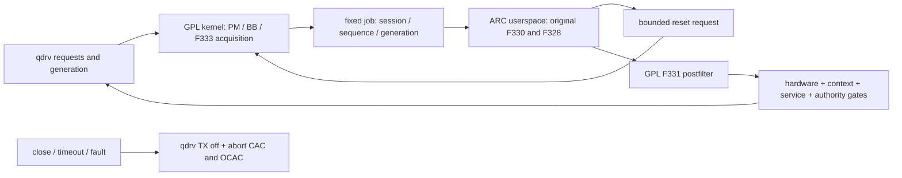

# F338: GPL kernel and separate ARC userspace OEM engine

2026-09-21. F338 replaces the F332 kernel module linkage that the actual
Linux5.10 loader rejects. F332's immutable NO-GO is preserved. F338 does not
change licenses or loader checks: proprietary F328/F330 machine code runs
in a normal Linux userspace process. GPL F331/F333 code stays in the kernel.
The classifier/preprocessor are no longer kernel module dependencies.

The source is `work/kernel-port/f338/`. This is a disabled component bundle,
not a flash image or a physical DFS release. Hardware, diagnostic acquisition
and callback authority all default off. The artifact rejects
`authoritative_enable=1` while `F338_RELEASE_QUALIFIED=0`.

## Runtime boundary

`/dev/om-radar-f338` is a mode0600 misc device and open requires
`CAP_SYS_ADMIN`. Only one open session is accepted. The shared BSD interface
is `uapi/f338_uapi.h`: header24B, job24072B, reply1048B, reset40B. It contains
fixed32-bit values and bounded arrays; there are no kernel pointers, physical
addresses, or arbitrary-register operations. Raw capacity is128, processed
capacity256, and preserved ZC matrix49×112. Tagged bytes are constructed from
validated wire0/1 values rather than aliasing user memory.

The worker captures and consumes using the exact F333/OEM order. It owns PM
across one transaction, drops BB and `state_lock`, and waits at most the
100ms software deadline for the service. The service cannot keep `ipc_lock`
while faulting user pages. The worker also performs reset RPCs itself, so a
late ioctl cannot perform hardware writes after the worker has released PM.
At most three reset requests are admitted per job; retransmission of the same
request-id returns the cached timestamp without repeating either write.

Reset success means the two original ordered counter writes were emitted and
a fresh realtime timestamp was obtained. It does not claim a stopped counter
or a hardware acknowledgement. OEM epoch arithmetic is realtime100ns modulo
32bits; timer advancement remains monotonic HZ200 units. These clocks are
deliberately separate.

The kernel samples actual synchronized qdrv `tx_bytes` at the original
pre-increment `%20` cadence. The detector poll runs at post-increment `%50`.
Scheduling remains50ms after the worker returns. Original counts and detector
statistics are retained before the two empty preprocessing flushes following
a candidate. The GPL postfilter receives all six valid input groups from
real frame/rate/reply data; a missing input is an error, never an invented0.
The tested EU profile includes weather and OCAC contexts.

## Cancellation, availability and lifetime

A channel/width/context change discards the old transaction. Sequence numbers
must increase, but a canceled unread job may leave a gap. A stale read,
calculation reply or reset response does not poison the service. Its mutable
math state is retired and the next generation begins cleanly. Replay is
rejected. A genuine engine/protocol failure closes the service session;
hardware failure latches the provider fault and stops acquisition.

The added kernel callback is
`radar_register_availability(void (*cb)(uint32_t generation, uint32_t reason))`.
Reasons1–4 are service-close, timeout, protocol-failure, hardware-failure.
They revoke READY immediately and notify qdrv from workqueue process context,
outside BB and provider locks. They are not radar detections and never invent
a NOP. qdrv cancels CAC/OCAC continuity and sends TX-off. A failed TX control
command remains a latched unknown hardware state, not a claimed successful
stop. Existing real radar/NOP flags are preserved.

Reason5 is SERVICE_READY, emitted only after the whole pipeline actually
publishes a new valid generation. It lets a restarted daemon recover after
qdrv's bounded5s retry has expired; qdrv re-enters readiness/CAC, never opens
TX directly from this notification. A valid empty capture can become ready.

`radar_wait_stopped()` closes callback admission, stops and joins the polling
worker, joins availability work, cancels any old IPC transaction, and removes
caller pointers before returning0. A concurrent service close cannot enqueue
a callback after that join. Calling the join from either owned worker or
atomic context is rejected. A direct `radar_start` is excluded while a
transaction or observer callback is using the workspace. The hardware backend
retains its existing self-pin after touching radio hardware; software teardown
does not claim to quiesce the OEM producer or permit unsafe module removal.

## Startup and shutdown contract

The bundle manifest supplies the complete module load order and exact hashes.
Use its coherent peers and F338 qdrv. Do not combine it with F321 qdrv's
internal radar exports, the F334 one-shot provider, or F335 WPS work.

1. Load the pinned GPL platform dependencies before `qtn_radar_f338.ko`.
2. Start the exact userspace binary explicitly with `--serve` and wait for its
   single `/dev/om-radar-f338` session. Module import never launches it.
3. Only then initialize qdrv. The native hardware bootstrap, when separately
   enabled by the physical candidate, runs in qdrv's original bring-up order.
   Callbacks are registered after `radar_start`; they do not authorize TX.
4. `radar_set_bw`, context registration, the first complete job and the
   qdrv readiness/CAC gate must succeed before any DFS transmission authority.

For shutdown, qdrv first disables radio requests and invokes its integrated
`radar_wait_stopped` drain before freeing IC/shared state. Stop the service
and wait for its exit; close wakes any pending transaction. A dirty hardware
provider remains pinned until the operator's controlled reboot/recovery.
An unarmed provider can unload after descriptors and consumers have closed.

`--selftest` never opens the device and has alarm10s plus CPU4/5s limits.
`--serve` has a separate2s alarm around each OEM calculation; the kernel's
100ms transaction deadline is independent. Neither deadline is a hardware
bus-hang recovery guarantee; watchdog and physical recovery remain separate.

## Evidence and limits

- Actual ARC/Linux5.10 execution passed398 checks and55 classifier vectors:
  `outputs/handoff-live/f338-ram-math-20260921T130615Z/result.json`.
  RAM cleanup passed; no UAPI, MMIO, UART, radio or flash action was involved.
- The initial selftest correctly failed at its wrongly specified reset
  threshold. OEM quiet-count100 does not reset; previous count101 does.
  Both boundaries are now tested. The original failed result is preserved.
- Private `analysis/f338-pipeline-20260921T132141Z/result.json` compares180
  windows and551 checks against the qualified F332 original-byte pipeline:
  counts, decisions, postfilter state, rate state, and all1000 cfg/stats bytes
  via hashes. It also exercises service cancellation and terminal failure.
  This combined private research oracle is never part of either deployable
  kernel module or userspace service.
- `outputs/preflight/f338-ipc-20260921T131909Z/result.json`:42 protocol checks,
  80 checks of actual kernel read/write/ioctl/exchange C with POSIX threads,
  plus4 actual service-main transport cases. It includes stalled user copy,
  consumer close, duplicate reset, cancellation before read/during math/during
  reset, and correct PM release. Hardware reset callbacks are explicit fakes.
- `outputs/preflight/f338-lifetime-20260921T131728Z/result.json`:8 actual
  callback/teardown cases, including a close injected after the join.
- Kernel and service builds are independently reproduced twice. Kernel
  imports and export types are checked against the exact F321 vmlinux and
  coherent GPL module graph; the final manifest supplies the closure/order.

The retained baseline `fwt_ctrl` module is still correctly Proprietary.
Its25 imports are ordinary `EXPORT_SYMBOL`; no bundle module imports its
exports. The audit preserves it and models per-module `inherit_taint` rather
than wrongly requiring every installed module to declare GPL. Neither the
F338 provider nor qdrv inherits proprietary taint, and no proprietary-tainted
module consumes GPL-only symbols. This makes no change to FWT's licensing,
callback architecture or the kernel's checks.

The local QEMU Linux-user emulator aborts its decoder even on the bounded
trivial control. It provides no pass evidence. The real HGW userspace test
above and the separate baremetal math oracle are distinct evidence. Host
ASan/UBSan runtime libraries were absent; protocol compiler analysis and the
threaded executable tests passed, with no sanitizer claim.

Physical UAPI/module loading, acquisition latency, recovery under watchdog,
RF radar/CAC/NOP acceptance, client traffic and release soak are unrun for
this bundle. The earlier F333 acquisition, F331 postfilter and native startup
oracles remain mathematical/sequence evidence, not physical RF acceptance.

Later external evidence, without modifying the sealed F338 bundle: the final
75,212-byte service binary SHA737cbdfeb429caba42929374c4a22eab549791c6af42fb3149c5ad64c048c85b
also passed398/55 in real ARC/Linux with `--selftest` in
`outputs/handoff-live/f338-ram-math-20260921T133822Z/result.json`. No UAPI/MMIO
was opened, the boot was unchanged, and RAM staging was cleaned up.
