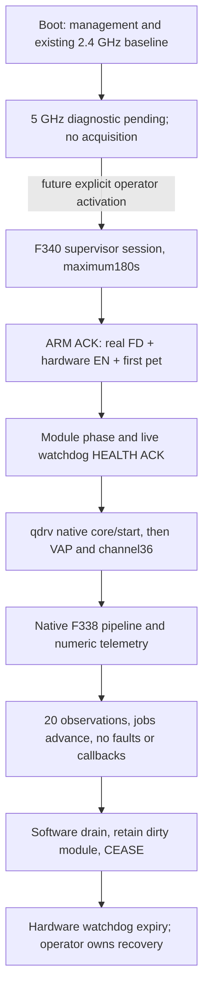

# F341 native DFS diagnostic image

2026-09-21. The complete image is built and reproduced offline. **Physical
radio/acquisition, Wi-Fi clients and RF/CAC/NOP acceptance are USER_DEFERRED.**
No router or AELITA access was performed by the implementation agent.

The candidate is in the private device firmware directory:
`f341-f340-native-diagnostic-device-bound/`.

| Item | Evidence |
|---|---|
| Webformat bytes | 5,406,720 |
| Webformat SHA256 | `f6c6184a4e08265a741f42df0a92a91a1cb2bf9aa513fabb0d861cff06494595` |
| Bootbase | PASS |
| Reproduction | Two independently repacked rootfs/full images, byte-identical |
| Rootfs headroom | 753,664 bytes before the reserved store boundary |
| Physical status | NO_GO_HW_AND_USER_DEFERRED_WIFI |

Build result:
`outputs/preflight/f341-fullimage-20260921T135223Z/result.json`.
The private candidate manifest supplies full-slot CRC/hash, all sidecar
hashes, source bindings, exact changed files, and complete catalogue checks
before packing and after unpacking. The image retains the exact F340 kernel,
DT and supervisor, the accepted F321 UI, identity, credentials and calibration.
The generic inherited `LAYOUT.md` describes the F164-format composer; the
F341 manifest and this document define this candidate's runtime contract.

## Components and ABI

F340 kernel source and headers were used to rebuild all26 modules twice in
an isolated output tree. Config SHA256:
`f374913b8d2adc7c4138af32263b650eeb967b4defc0139cfd00e6bff7ba1118`.
The source F340 output was not changed. Its missing external-module linker
script was generated with `modules_prepare` in the new F341 context.

The closure manifest is private
`analysis/f341-closure-20260921T134402Z/manifest.json`. All26 modules reproduce
exactly; 1,081 imports resolve against the actual F340 kernel/module exports,
with export types and a cycle-free load order checked. The standalone
baseline `fwt_ctrl` retains its Proprietary declaration. It neither imports
GPL-only symbols nor taints the F341 provider/qdrv through imports. No OEM
classifier or preprocessor kernel module is installed.

| Component | Bytes | SHA256 |
|---|---:|---|
| `qtn_radar_f341.ko` | 69,608 | `e6b86f1320387e795a4f9d2d5e05fdaf717f576c4d29ef38320edd7688c50869` |
| `qdrv.ko` | 686,736 | `74d208aa46c65222da47260c418bb3f7333aedf8895844b90c15e466d7a86b42` |
| F338 userspace engine, installed as `om-radar-engine-f341` | 75,212 | `737cbdfeb429caba42929374c4a22eab549791c6af42fb3149c5ad64c048c85b` |

The engine is the exact final F338 binary. It also passed398 checks and55
classifier vectors in real HGW ARC/Linux userspace, without opening UAPI or
MMIO: `outputs/handoff-live/f338-ram-math-20260921T133822Z/result.json`.
Renaming its installed file does not alter its code or F338 wire ABI.

No F335 WPS workflow or F339 thermal change is included.

## Controlled activation

The normal boot call to `om-radio5-start` only reports pending and returns.
It does not load the diagnostic radio or open a watchdog. The explicit
controller is `om-f341-diagnostic activate TOKEN32`; it is not called by any
init script, UI write route, heartbeat or startup automation. The current
USER_DEFERRED restriction prohibits running that activation campaign.

The controller starts the exact F340 supervisor, obtains ARM acknowledgement,
and only then admits the native ladder. A direct invocation of the private
ladder must also obtain a live HEALTH ACK before loading qdrv dependencies.
Neither a cached file nor a PID alone establishes watchdog readiness. The
canonical F340 client verifies nonce, boot ID, PID start time, peer credentials,
sequence and command acknowledgement.

Phases are module-load30s, core-start30s, VAP-create30s, radio-nonDFS45s and
pipeline-observe30s. The absolute180s session deadline overrides the sum of
phase limits. HEALTH cannot extend a phase or session; COMPLETE gives only
the supervisor's bounded5s transition interval. The supervisor alone owns
the watchdog FD. No second process opens, adopts, disarms or pets that device.

The native ladder preserves the actual calibrated bring-up order, creates
the service before `radar_start`, and uses channel36/BW80 with DFS callback
authority false. The old one-shot capture provider and late SRAM arming are
removed. The pipeline still uses actual FIFO/ZC data and the original
preprocess/classifier/postfilter behavior; diagnostic mode does not replace
inputs with zero. The original broad shell rollback timer is removed from
this bounded diagnostic ladder; the armed hardware watchdog provides its
recovery timeout.

## Observation and stop semantics

`om-f341-status` and the authenticated read-only DFS route publish only
allowlisted numbers: job counts, cancellations, timeouts, protocol/hardware
errors, reset requests/emitted sequences/replays, last/max job latency, PM
attempts/acquisitions/releases/busy state, generations, channel and callback
counts. Latency is measured from kernel jiffies, not an RF timing claim.
No raw pulse/ZC arrays, detector blobs, calibration, MACs or credentials are
included. Duplicate telemetry keys fail rather than emitting ambiguous JSON.

The observation window requires completed jobs to increase, postfilter
execution, channel36, zero callbacks and no reported engine/IPC/hardware
faults. Its completion is a diagnostic observation, not RF acceptance.

Writing the exact `STOP_DIAGNOSTIC` command drains the provider's software
work and callbacks and prevents restart in the same boot. It does not claim
the producer is quiescent. The dirty module stays pinned; neither stop helper
nor controller unloads it. CEASE stops supervisor feeding while retaining the
FD, allowing the hardware watchdog to reset. Recovery remains an explicit
part of the root operator's future campaign.

## Verification and remaining gates

- `outputs/preflight/f341-ipc-20260921T133749Z/result.json`:42 protocol checks,
  83 actual kernel IPC/telemetry checks and4 actual userspace transport cases.
- `outputs/preflight/f341-control-20260921T135050Z/result.json`:8 actual C
  stop/PM cases; F338 lifetime drain remains unchanged.
- `outputs/preflight/f341-runtime-20260921T134922Z/result.json`:24 offline
  shell/ordering/privacy tests with explicit fake watchdog/proc backends.
- `outputs/preflight/f341-f340-ipc-20260921T134922Z/result.json`:actual F341
  scripts and F340 supervisor/client processes, ARM/phase/CEASE acknowledgements
  verified; watchdog and radio backends were explicitly fake.
- F338's original math and acquisition oracles remain applicable because those
  component sources/objects were preserved; the final engine has real
  ARC/Linux userspace execution evidence as listed above.

The first physical watchdog cessation test passed separately in
`outputs/handoff-live/f336-ram-20260921T133950Z-51c6016b/result.json`: reset and
F321 return were observed8.766–8.782s after feeding stopped, with the flash CRC
unchanged. It did not prove reset cause, full-chip reset, watchdog clock rate,
or recovery from CPU/bus halt. F340/F341 boot and radio acquisition are not
claimed physically passed. Wi-Fi/client/RF gates remain USER_DEFERRED.
